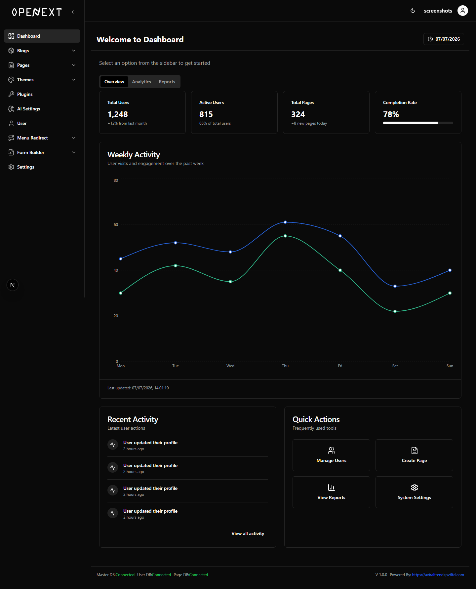
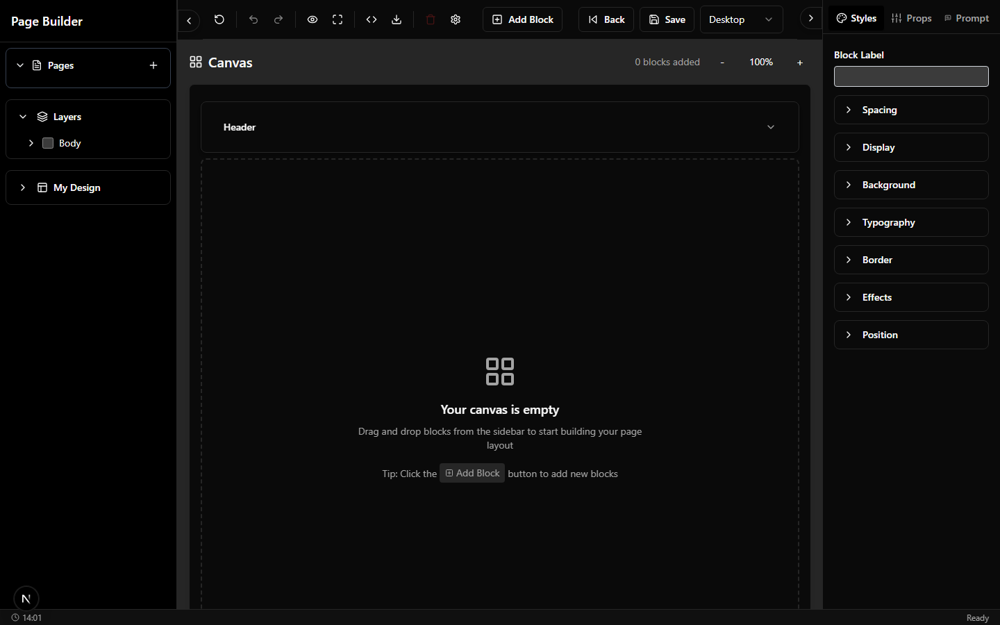
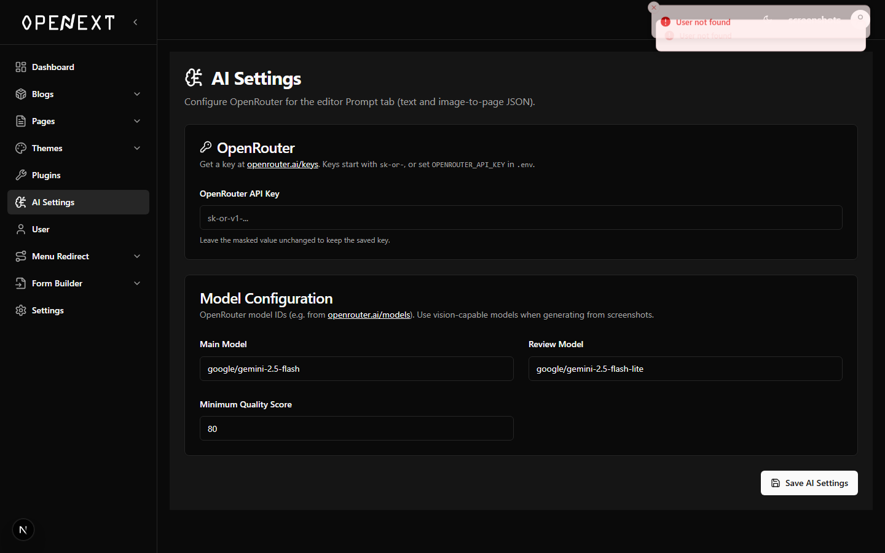
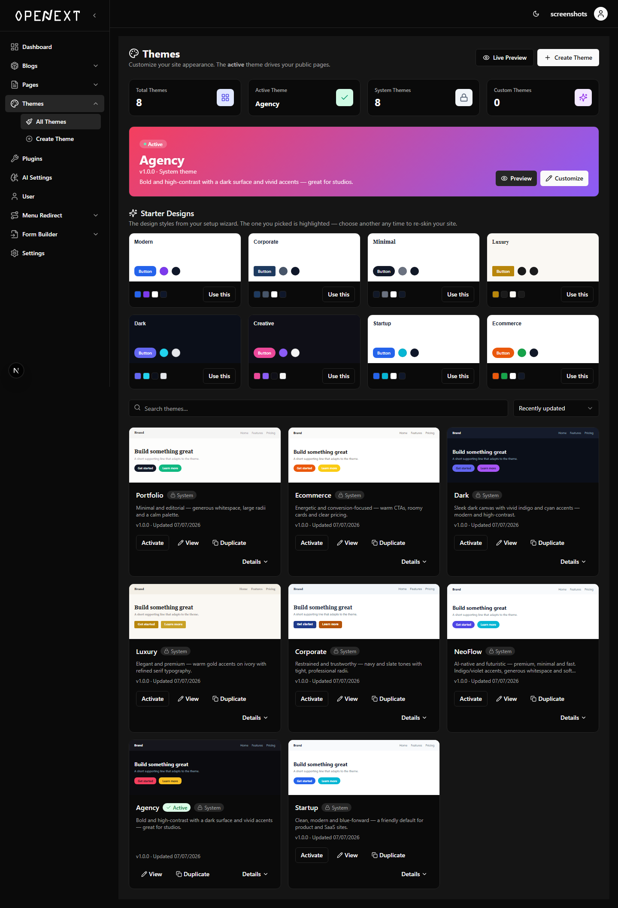

# OpenNext CMS

**An AI-Assisted, Multi-Tenant Content Management & Website-Builder Platform**

Build, style and publish complete websites from the browser — no code — with a visual
drag-and-drop editor, an AI page generator, a blog engine, a form builder, a theme builder and
role-based multi-user access. Built on **Next.js 15**, **React 19**, **TypeScript** and **MongoDB**.

> Organization: **Aviral Trendz Private Limited** · Developer: **Khadija Mama** · Academic Year 2025–2026

---

## Table of Contents

- [Overview](#overview)
- [Key Features](#key-features)
- [Tech Stack](#tech-stack)
- [Architecture](#architecture)
- [Database Schema](#database-schema)
- [API Reference](#api-reference)
- [The Block System](#the-block-system)
- [AI Page-Generation Subsystem](#ai-page-generation-subsystem)
- [Project Structure](#project-structure)
- [Getting Started](#getting-started)
- [Environment Variables](#environment-variables)
- [Screenshots](#screenshots)
- [Testing](#testing)
- [Future Enhancements](#future-enhancements)
- [Team & Credits](#team--credits)

---

## Overview

OpenNext CMS is a full-stack CMS and visual website builder. A user registers, is guided through
an onboarding wizard that scaffolds a starter site, and then works in a visual editor where a page
is an ordered tree of **block** objects held in Redux state. Pages can be built by (a) dragging
blocks from a palette, (b) typing a natural-language prompt so the AI generates a full page, or
(c) pasting a generated page document (JSON) to render it directly.

Saving persists the block tree to MongoDB; publishing exposes the page at its slug, where the
front-end merges the active global header/footer, applies the active theme's CSS variables and
renders the page server-side with incremental static regeneration (ISR). Parallel modules manage
blogs, forms, themes, plugins and analytics through the same authenticated API layer.

A distinctive characteristic of the platform is its **multi-tenant, three-database architecture**
(a master routing DB, a user DB and a per-tenant page/content DB), giving each tenant physical
data isolation.

---

## Key Features

| Module | What it does |
|---|---|
| 🎨 **Visual Page Builder** | Drag-and-drop canvas (`@dnd-kit`), ~60 block types, layer tree, per-block Styles/Props panels, undo/redo (50-step history), responsive desktop/tablet/mobile preview (real-width iframe), zoom, JSON import/export. |
| 🤖 **AI Page Generation** | Turns a plain-English prompt *or* a reference image into a complete, editable page on the canvas via a two-stage pipeline (structure model + copy model). Includes **Paste-JSON-to-Canvas** (render any page document with no AI call). |
| 📝 **Blog Engine** | Posts, categories, tags, authors, comments, scheduled publishing, draft/published/archived states, SEO metadata + JSON-LD, reading-time, slug-history 301 redirects, per-visitor analytics. |
| 🧩 **Form Builder** | Drag-and-drop builder with 20+ field types, conditional logic, validation rules, multi-step forms, spam protection (honeypot / Turnstile / throttle), submissions, webhooks, email notifications, version history and analytics. |
| 🌈 **Theme Builder** | Config-driven design tokens (colors, typography, spacing, radius, shadows, layout) applied site-wide via CSS variables, with a live-preview builder and seeded system themes. |
| 🧭 **Onboarding Wizard** | 6-step animated flow (business → website type → header → footer → theme → review) that scaffolds a starter website, with autosave. |
| 👥 **Platform Services** | Role-based multi-user access (SuperAdmin/Admin/Editor/Author), plugin architecture, menu-redirect / URL-management plugin, analytics dashboard, and a 15-language localization layer with light/dark presentation. |

---

## Tech Stack

**Frontend**
- Next.js 15 (App Router) · React 19 · TypeScript 5
- Redux Toolkit + React-Redux + `redux-persist` (custom storage)
- `@dnd-kit` (drag & drop) · `framer-motion` (animation)
- Tailwind CSS + `tailwind-merge` + `class-variance-authority` · Radix UI primitives (shadcn/ui-style)
- `react-hook-form` + `zod` · `next-themes` (light/dark) · `recharts` (charts) · `lucide-react` (icons)

**Backend**
- Next.js Route Handlers (`/api/**`) · Node.js 20+
- MongoDB 6 via Mongoose 8 (multi-database, per-tenant)
- `bcryptjs` (password hashing) · JWT (HS256, HttpOnly cookie) · `zod` (validation)
- `jszip` (theme/plugin ZIPs) · `sharp` (image processing) · `cheerio` / `isomorphic-dompurify` / `jsonrepair`

**AI / ML**
- **Stage 2 (copy):** OpenRouter → Google Gemini 2.5 Flash (main) / Gemini 2.5 Flash-Lite (review)
- **Stage 1 (structure):** fine-tuned **Qwen2.5-1.5B-Instruct** (QLoRA / PEFT, PyTorch, bitsandbytes) — see [`training/layout-planner`](training/layout-planner)
- `node-vibrant` (palette extraction)

**Tooling**: GitLab · ESLint · Prettier · Playwright (screenshots) · Google Colab T4 (model training)

---

## Architecture

Layered architecture with a multi-tenant data tier:

```
┌───────────────────────────────────────────────────────────────────────┐
│ PRESENTATION  — Next.js App Router + React 19                          │
│ Visual editor (@dnd-kit) · Redux (canvasSlice + persist) ·             │
│ Right sidebar (Styles / Props / Prompt) · Dashboard · Public pages     │
└───────────────────────────────┬───────────────────────────────────────┘
                                 │ HTTP (fetch)
┌───────────────────────────────▼───────────────────────────────────────┐
│ APPLICATION / API — Next.js Route Handlers (/api/**)                   │
│ JWT cookie auth + edge middleware · Zod validation · response envelope │
│ Pages · Blogs · Forms · Themes · Plugins · Analytics · AI · Onboarding │
└───────────────────────────────┬───────────────────────────────────────┘
                                 │
        ┌────────────────────────┴─────────────┐
        ▼                                       ▼
┌──────────────────────┐            ┌──────────────────────────┐
│ AI SUBSYSTEM         │            │ DATA — Mongoose 8         │
│ Stage-1 Qwen + LoRA  │◄──────────►│ master / user / page DBs  │
│ Stage-2 OpenRouter   │            │ (per-tenant isolation)    │
└──────────────────────┘            └──────────────────────────┘
```

**Multi-database, per-tenant model** (`src/utils/db.ts`) — three lazily-created, cached Mongoose
connections:

| Database | Collections |
|---|---|
| **master** | `MasterDb` (tenant → user/page DB routing) |
| **user DB** | `User`, `Role`, `Settings`, `Plugin` |
| **page DB** (per tenant) | `Page`, `BlogPost`, `Category`, `Tag`, `Author`, `Comment`, `AnalyticsEvent`, `Layout`, `Theme`, `ThemeSettings`, `Form`, `FormSubmission`, `FormVersion`, `WebsitePreferences`, `MenuRedirect*` |

Because tenants are separated by **physical database**, uniqueness constraints (e.g. `slug`) apply
per tenant. Default roles and settings are seeded on first connect; system themes auto-seed on the
page-DB connection.

**Key sequences**
- *Generate Page*: Prompt Tab → `POST /api/ai/generate-page-json` → (Stage-1 structure → validate/retry → Stage-2 copy fill) → normalize to `BlockData[]` → `dispatch(setBlocks)` → canvas → optional Save.
- *Publish & Serve*: Save → `isPublished=true` → `revalidatePath('/slug')` → visitor request → server fetch page + global header/footer → `SiteThemeProvider` injects theme CSS vars → blocks rendered from JSON → HTML (ISR, revalidate 30s).

---

## Database Schema

Selected collections (representative fields; `*` = unique index). Full schemas in `src/models/`.

**User DB**

- **User** — `username*`, `email*`, `password`, `role` (0 SuperAdmin … 3 Author), `firstName`, `lastName`, `active`, `onboardingCompleted`
- **Role** — `name*`, `value*`
- **Settings** — `siteTitle`, `language`, `timeZone`, `themes[]`, `config[]`, `aiConfig{ openrouterApiKey, openrouterModel, openrouterReviewModel, aiMinQualityScore }`
- **Plugin** — `pluginId*`, `name`, `version`, `type`, `isActive`, `entryPoint`

**Page DB**

- **Page** — `pageName`, `slug*`, `pageType`(page/header/footer), `isPublished`, `isHome`, `isGlobal`, `component[]` (block tree), `modifications[]`, SEO fields
- **BlogPost** — `pageName`, `slug*`, `contentBlocks[]`, `categories[]→Category`, `tags[]→Tag`, `authorId→Author`, `seo{}`, `status`, `publishedAt`, `views`, `slugHistory[]`, `commentsEnabled`
- **Category** — `name`, `slug*`, `parentCategory→Category` (self-ref) · **Tag** — `name`, `slug*` · **Author** — `name`, `email`, `bio`, `socialLinks{}`
- **Comment** — `blogId→Page`, `name`, `email`, `comment`, `status`(pending/approved/spam)
- **AnalyticsEvent** — `blogId`, `type`(view/read/search), `visitorId`, `durationSec`, `query` (append-only)
- **Theme** — `name`, `slug*`, `isActive`, `isSystemTheme`, `theme{colors,typography,spacing,radius,shadows,layout}` · **ThemeSettings** — blog design tokens
- **Form** — `name`, `slug*`, `status`, `fields[]`, `settings{}`, `analytics{}`, `versions[]` · **FormSubmission** — `formId→Form`, `submissionData{}`, `webhookAttempts[]` · **FormVersion** — `formId`, `version`, `snapshot`
- **WebsitePreferences** — `userId*`, `businessName`, `websiteType`, `header/footer/theme`, `onboardingCompleted`, `draft`
- **MenuRedirectMapping / Analytics / History** — header menu-item → redirect target mappings, click counters and an append-only audit log

**Principal relationships**

```
User 1 ──< N Page / BlogPost / Form            (ownership)
Page 1 ──< N Comment ; Page 1 ──< N AnalyticsEvent
BlogPost N ──< >── N Category / Tag ; BlogPost N ── 1 Author
Category 1 ──< N Category (self)               (nested categories)
Form 1 ──< N FormSubmission ; Form 1 ──< N FormVersion
Role 1 ──< N User ; Settings 1 ── 1 aiConfig
MasterDb ── routes ── userDB + pageDB          (tenancy)
```

---

## API Reference

All endpoints are Next.js Route Handlers under `src/app/api/`. Auth is a JWT in an HttpOnly cookie.

**Auth** — `POST /api/auth/login`, `GET /api/auth/logout`, `POST /api/auth/admin` (first-run super-admin + DB/`.env` bootstrap), `POST /api/auth/setup-databases`, `POST /api/auth/verify-mongodb`, `GET /api/check-token`, `GET /api/dashboard` (profile), `POST /api/sub-users/add-users`, `GET /api/sub-users/get-users`

**Pages** — `POST /api/pages/add-page`, `PATCH /api/pages/update-page`, `GET /api/pages/get-page`, `GET /api/pages/get-pages`, `DELETE /api/pages/delete-page`

**Blogs** — `GET|POST /api/blogs`, `GET|PUT|DELETE /api/blogs/[id]`, `GET /api/blogs/slug/[slug]` (public, slug-history fallback), `POST /api/blogs/upload-image`, `GET /api/public/blogs`, CRUD for `/api/categories`, `/api/tags`, `/api/authors`, `/api/comments`, and `GET|POST /api/cron/publish-scheduled`

**Forms** — `GET|POST /api/forms`, `GET|PUT|DELETE /api/forms/[id]`, `POST /api/forms/[id]/submit` (public; spam checks + webhook + email + analytics), `GET /api/forms/[id]/submissions`, `GET /api/forms/[id]/analytics`, `POST /api/forms/[id]/track`, `POST /api/forms/[id]/duplicate`, `GET|POST /api/forms/[id]/versions`, `GET /api/forms/render/[idOrSlug]`, plus `POST /api/forms/ai/{generate,optimize,validation}`

**Themes** — `GET|POST /api/themes`, `GET|PUT|DELETE /api/themes/[id]`, `POST /api/themes/[id]/duplicate`, `POST /api/themes/activate`, `GET /api/themes/get-theme`, `POST /api/themes/extract`, `GET|PUT /api/theme-settings`

**AI** — `POST /api/ai/generate-page-json` (flagship: prompt/image → full page block tree, two-pass generate+review), `POST /api/ai/{generate-blog,generate-faq,generate-meta-description,generate-seo-title,rewrite,summarize,expand}`, `POST /api/onboarding/generate`

**Dashboard / Settings** — `GET|POST /api/dashboard/settings`, `POST /api/dashboard/settings/siteicon`, `GET|POST /api/dashboard/ai-settings`, `GET|POST /api/dashboard/profile`, `GET|POST /api/env-connection`, `GET /api/verify-connection`

**Plugins** — `GET /api/dashboard/plugins/get-plugins`, `POST .../install-plugin`, `POST .../upload-plugin`, `PATCH .../toggle-plugin`, `PATCH .../update-plugin`, `DELETE .../remove-plugin`

**Analytics** — `POST /api/analytics/track` (public beacon), `GET /api/analytics/summary`

**Menu-Redirect** — ~25 routes under `/api/menu-redirect/*` (create/update/delete/list/bulk mappings, lifecycle install/enable/disable, history + undo, track + analytics, public merged menu, data-source helpers)

---

## The Block System

Every block is a `BlockData` object (`src/redux/canvasSlice.ts`, mirrored in `src/types/index.ts`)
— roughly **60 types** grouped as:

- **Layout / primitives:** `column`, `row`, `text`, `button`, `icon`, `image`, `card`, `separator`, `shape-divider`
- **Form inputs:** `input`, `radio`, `checkbox`, `switch`, `textarea`, `form-block`
- **UI atoms:** `badge`, `alert`, `avatar`, `table`, `tabs`, `progress`, `countdown`, `stats`, `slider`
- **Hero:** `hero`, `hero-main`, `hero-centered`
- **Sections:** `statistics-*`, `testimonial-*`, `content-*`, `feature-*` (trio, vertical, side-image, zigzag, checklist…)
- **Ecommerce:** `ecommerce-grid`, `ecommerce-detail`, `ecommerce-info`
- **Navigation / contact / blog:** `nav-bar`, `contact`, `contact-simple`, `blog-feed`

Blocks render through `src/components/editor/renderblock.tsx` (editable primitives in
`components/editor/blocks/*`, rich sections in `components/ui/*`, plugin blocks via `pluginRegistry`).
Nested structure (`children[][]`) supports column/row layouts.

---

## AI Page-Generation Subsystem

A deliberate **two-stage pipeline** balances quality, cost and control:

```
Brief ──► Stage 1: Layout Planner ──► LayoutPlan JSON ──► Validate / Retry / Retrieval
          (Qwen2.5-1.5B + LoRA)       (structure only)              │
                                                                    ▼
                                       Stage 2: Content Filler ──► Full v2 page JSON ──► Editor
                                       (OpenRouter / Gemini 2.5)
```

- **Stage 1 — Layout Planner:** a fine-tuned `Qwen2.5-1.5B-Instruct` (QLoRA) emits **structure-only**
  `LayoutPlan` JSON — section types, order, theme and per-section styles, but no copy. A rule
  validator enforces nav-first, footer-last, exactly-one-hero, kebab-case unique IDs and
  complexity-based block counts. Runs locally (Python, `transformers` + `peft`) at no per-call cost.
- **Stage 2 — Content Filler:** a hosted model (Gemini 2.5 Flash via OpenRouter) fills realistic,
  niche-specific copy into the fixed structure, producing a v2 page document the editor consumes.

The result: a small, cheap, self-hostable model owns the deterministic layout while an API model
handles only creative copy. Training data, notebooks and evaluation harness live in
[`training/layout-planner`](training/layout-planner) (best validation loss **0.0215**, 100% schema-pass
on the evaluated subset).

---

## Project Structure

```
nextcmsmains/
├─ src/
│  ├─ app/                     # Next.js App Router
│  │  ├─ (auth)/               # login, language, admin, mongodb-setup
│  │  ├─ api/                  # route handlers (auth, pages, blogs, forms, themes, ai, …)
│  │  ├─ dashboard/            # admin: pages, blogs, themes, plugins, ai-settings, users, analytics
│  │  ├─ Editor/               # visual page builder entry
│  │  ├─ onboarding/           # startup wizard
│  │  ├─ blog/ · [slug]/ · preview/ · themes/   # public + preview rendering
│  ├─ components/
│  │  ├─ editor/               # canvas, toolbar, sidebars, blocks, renderblock, Prompt tab
│  │  ├─ ui/                   # rich section components (hero, features, ecommerce, …)
│  │  ├─ blog/ · form-builder/ · theme-builder/ · theme-preview/
│  ├─ models/                  # 21 Mongoose schemas
│  ├─ redux/                   # canvasSlice, formBuilderSlice, themeBuilderSlice, store
│  ├─ lib/                     # ai/, theme/, form-builder/, menu-redirect/, api/ helpers
│  ├─ utils/                   # db.ts (multi-tenant connections), jwt, getPageData, …
│  ├─ templates/ · types/ · providers/ · modules/auth/
├─ training/layout-planner/    # Stage-1 model: schema, validator, data pipeline, notebooks, eval
├─ public/locales/             # 15 language files
├─ scripts/                    # screenshots.mjs, test-v2-generate.mjs
└─ docs/                       # report + screenshots
```

---

## Getting Started

**Prerequisites:** Node.js 20+, a MongoDB instance (local or Atlas), and (optional) an OpenRouter API key.

```bash
# 1. install dependencies
npm install

# 2. create .env  (see Environment Variables below)

# 3. run the dev server (http://localhost:3011)
npm run dev
```

First run redirects to a setup flow (`/language` → MongoDB setup → super-admin registration) that
provisions the master/user/page databases and writes DB credentials + a generated `JWT_SECRET`
into `.env`. After setup, log in and complete the onboarding wizard.

**Scripts**

| Command | Purpose |
|---|---|
| `npm run dev` | Dev server on port **3011** |
| `npm run build` / `npm run start` | Production build / serve |
| `npm run lint` / `npm run lint:fix` | ESLint |
| `npm run format` / `npm run format:check` | Prettier |
| `npm run test:v2` | v2 page-generation smoke test |

---

## Environment Variables

Stored in `.env` (never committed). Managed partly at runtime via the setup wizard.

| Variable | Purpose |
|---|---|
| `MONGODB` | Connection mode: `uri` \| `atlas` \| `compass` |
| `MONGODB_URI` | MongoDB connection string |
| `USER_DB_NAME` / `PAGE_DB_NAME` | User / page database names (default `users` / `pages`) |
| `JWT_SECRET` | HS256 signing secret (auto-generated at registration) |
| `WEB_ACCESS_KEY` | Static access key for select public data endpoints |
| `OPENROUTER_API_KEY` | AI provider key (Stage-2 copy + AI endpoints) |
| `OPENROUTER_MODEL` | Model id (default `google/gemini-2.5-flash`) |
| `CRON_SECRET` | Optional bearer for the scheduled-publish cron endpoint |

---

## Screenshots

| Dashboard | Visual Page Builder |
|---|---|
|  |  |

| AI Settings | Theme Builder |
|---|---|
|  |  |

---

## Testing

- **Functional:** login (valid/invalid), page CRUD + duplicate-slug handling, AI generate,
  Paste-JSON-to-Canvas, blog publish + slug-change 301, form submission (spam/valid), theme
  activation, responsive preview, undo/redo, AI provider-failure fallback.
- **AI model evaluation:** `valid_json_rate`, `schema_pass_rate` (≥ 80% target — **100%** on the
  evaluated subset), `nav_footer_order_rate`; training converged cleanly (val loss 0.0215, no overfitting).
- **Static checks:** ESLint + `tsc --noEmit` clean on modified modules; offline pipeline smoke tests.

---

## Future Enhancements

- Harden authentication (cryptographic JWT verification on every route + route-level RBAC).
- Move media uploads from local filesystem to object storage (S3 / Cloudinary).
- **Visual version control** for pages — Git-style branching, visual diff and time-travel restore.
- Faster local AI inference (GGUF quantization); streaming generation with live preview.
- Real-time multi-user (Figma-style) editing via CRDTs.
- Accessibility & SEO guarantees enforced by the validator (WCAG contrast, heading order).
- Broader automated test suite (Jest + Playwright).

---

## Team & Credits

- **Developer:** Khadija Mama
- **Organization:** Aviral Trendz Private Limited
- **Academic Year:** 2025–2026

Built with Next.js, React, MongoDB, Hugging Face Transformers, PEFT, Qwen and OpenRouter.

---

*This document describes the OpenNext CMS platform. For the Stage-1 AI model sub-project, see
[`training/layout-planner/README.md`](training/layout-planner/README.md). For the formatted project
report, see [`docs/`](docs/).*
