# OpenExtCMS — System Design

> A multi-tenant, block-based Content Management System built on **Next.js 15 (App Router) · React 19 · MongoDB/Mongoose · Redux Toolkit · JWT auth · OpenRouter AI**.
> All diagrams below are authored in [Mermaid](https://mermaid.js.org/) and render natively on GitHub/GitLab and most Markdown viewers.

## Table of contents

1. [Database Design](#1-database-design)
   - [1.1 Tenancy model (3 physical databases)](#11-tenancy-model-3-physical-databases)
   - [1.2 Entity–Relationship diagram](#12-entityrelationship-diagram)
   - [1.3 Embedded document structures](#13-embedded-document-structures)
2. [Architecture & UML](#2-architecture--uml)
   - [2.1 System / structure chart](#21-system--structure-chart)
   - [2.2 Class diagram (domain & service layer)](#22-class-diagram-domain--service-layer)
   - [2.3 Sequence diagrams](#23-sequence-diagrams)
   - [2.4 Activity diagrams](#24-activity-diagrams)
   - [2.5 State-transition diagrams](#25-state-transition-diagrams)
3. [Forms Design](#3-forms-design)
4. [Reports Design](#4-reports-design)

---

# 1. Database Design

## 1.1 Tenancy model (3 physical databases)

Tenancy is **not** a `tenantId` column — it is **physical database separation**. `src/utils/db.ts` maintains three lazily-cached Mongoose connections and registers each schema onto the correct connection. Cross-database references (e.g. `Page.createdBy → User`) are **logical only** (dashed in the ER diagram), because the two collections live in different databases.

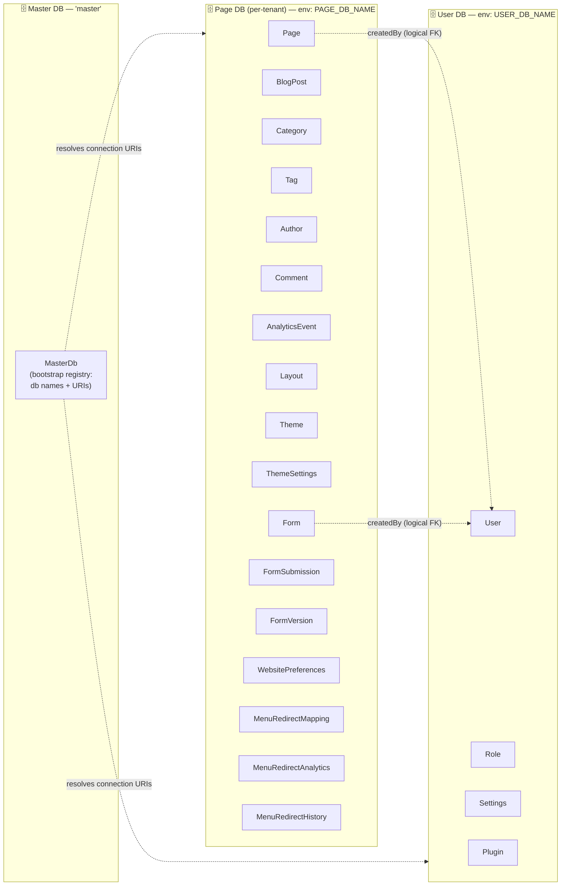

## 1.2 Entity–Relationship diagram

Solid lines = referential integrity within a single database. Dashed relationships in §1.1 are cross-DB logical links.

```mermaid
erDiagram
    %% ============ USER DB ============
    User {
        ObjectId _id PK
        string   username UK
        string   email UK
        string   password  "bcrypt hash"
        number   role      "FK->Role.value"
        string   firstName
        string   lastName
        string   displayName
        boolean  active
        boolean  onboardingCompleted
        date     createdAt
    }
    Role {
        ObjectId _id PK
        string   name UK  "SuperAdmin|Admin|Editor|Author"
        number   value UK "0|1|2|3"
    }
    Settings {
        ObjectId _id PK
        string   siteTitle
        string   language
        string   timeZone
        array    themes    "[{name,isActive}]"
        object   aiConfig  "openrouter keys + model"
    }
    Plugin {
        ObjectId _id PK
        string   pluginId UK
        string   name
        string   version
        string   source "uploaded|marketplace|builtin"
        boolean  isActive
        boolean  hasUpdate
    }

    %% ============ PAGE DB — content ============
    Page {
        ObjectId _id PK
        string   pageName
        ObjectId createdBy FK "->User (logical)"
        string   pageType "page|header|footer"
        string   slug UK
        boolean  isPublished
        boolean  isHome
        array    component "block-tree JSON"
    }
    BlogPost {
        ObjectId _id PK
        string   pageName
        ObjectId createdBy FK "->User (logical)"
        string   slug UK
        string   status "draft|published|scheduled|archived"
        ObjectId authorId FK "->Author"
        array    categories FK "->Category[]"
        array    tags FK "->Tag[]"
        object   seo
        number   views
        date     publishedAt
    }
    Author {
        ObjectId _id PK
        string   name
        string   email
        string   bio
        object   socialLinks
    }
    Category {
        ObjectId _id PK
        string   name
        string   slug UK
        ObjectId parentCategory FK "->Category (self)"
    }
    Tag {
        ObjectId _id PK
        string   name
        string   slug UK
    }
    Comment {
        ObjectId _id PK
        ObjectId blogId FK "->Page"
        string   name
        string   email
        string   comment
        string   status "pending|approved|spam"
    }
    AnalyticsEvent {
        ObjectId _id PK
        ObjectId blogId FK "->Page"
        string   type "view|read|search"
        string   visitorId
        number   durationSec
        string   query
        date     createdAt
    }
    Layout {
        ObjectId _id PK
        string   name
        boolean  isActive
        array    sections "[{type,visible,responsive}]"
    }
    Theme {
        ObjectId _id PK
        string   name
        string   slug UK
        boolean  isActive
        object   theme "design tokens"
    }
    ThemeSettings {
        ObjectId _id PK
        object   typography
        object   colors
        object   layout
        string   darkMode "light|dark|auto"
    }
    WebsitePreferences {
        ObjectId _id PK
        ObjectId userId UK "->User (logical)"
        string   businessName
        boolean  onboardingCompleted
        boolean  draft
        array    generatedPageSlugs
    }

    %% ============ PAGE DB — forms ============
    Form {
        ObjectId _id PK
        string   name
        string   slug UK
        string   status "draft|published|archived"
        array    fields "embedded FormField[]"
        object   settings
        object   analytics
        ObjectId createdBy FK "->User (logical)"
    }
    FormSubmission {
        ObjectId _id PK
        ObjectId formId FK "->Form"
        map      submissionData
        string   ipAddress
        string   webhookStatus "pending|sent|failed"
        date     createdAt
    }
    FormVersion {
        ObjectId _id PK
        ObjectId formId FK "->Form"
        number   version
        object   snapshot "full Form copy"
    }

    %% ============ PAGE DB — menu redirect plugin ============
    MenuRedirectMapping {
        ObjectId _id PK
        string   headerId
        string   menuItemId
        string   targetType "page|blog|anchor|external|cms"
        boolean  enabled
    }
    MenuRedirectAnalytics {
        ObjectId _id PK
        ObjectId mappingId FK "->MenuRedirectMapping"
        number   clicks
        date     lastClickedAt
    }
    MenuRedirectHistory {
        ObjectId _id PK
        string   action
        ObjectId userId FK "->User (logical)"
        date     createdAt
    }

    %% ============ RELATIONSHIPS ============
    User               ||--o{ Page                 : creates
    User               ||--o{ BlogPost             : authors
    User               ||--o{ Form                 : owns
    User               ||--o{ WebsitePreferences   : configures
    User               }o--|| Role                 : "has (by value)"
    BlogPost           }o--|| Author               : "written by"
    BlogPost           }o--o{ Category             : categorized
    BlogPost           }o--o{ Tag                   : tagged
    Category           ||--o{ Category             : "parent of"
    Page               ||--o{ Comment              : receives
    Page               ||--o{ AnalyticsEvent       : generates
    Form               ||--o{ FormSubmission       : collects
    Form               ||--o{ FormVersion          : snapshots
    MenuRedirectMapping ||--|| MenuRedirectAnalytics : "tracked by"
```

> **Design notes**
> - Both `Page` (with `pageType`) **and** `BlogPost` model content; blog comments and analytics reference **`Page`**, not `BlogPost`.
> - `User.role` is a *soft* foreign key: it stores `Role.value` (a number), not an `ObjectId`.
> - `BlogPost ⇄ Category` and `BlogPost ⇄ Tag` are many-to-many via `ObjectId[]` arrays embedded on `BlogPost`.

## 1.3 Embedded document structures

These sub-schemas are stored **inline** (`_id: false`) inside their parent document rather than as separate collections.

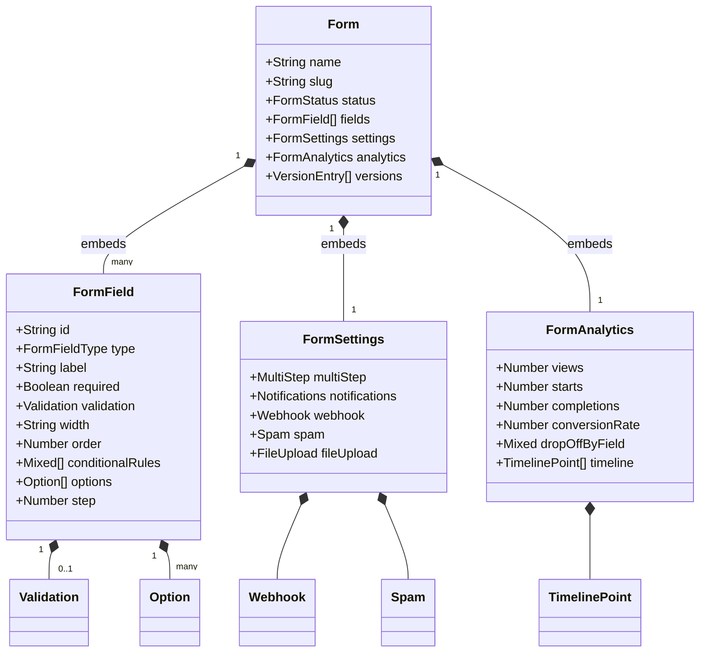

---

# 2. Architecture & UML

## 2.1 System / structure chart

Layered view of the running system, from browser to database.

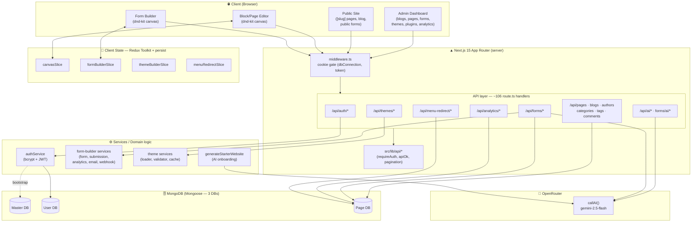

## 2.2 Class diagram (domain & service layer)

Key server-side classes/modules and how they collaborate.

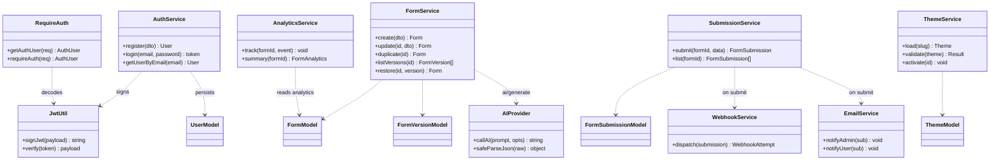

## 2.3 Sequence diagrams

### 2.3.1 Admin login (JWT issuance)

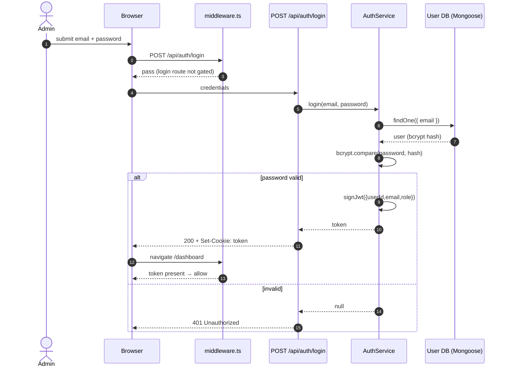

### 2.3.2 Public form submission (with webhook + email + spam guard)

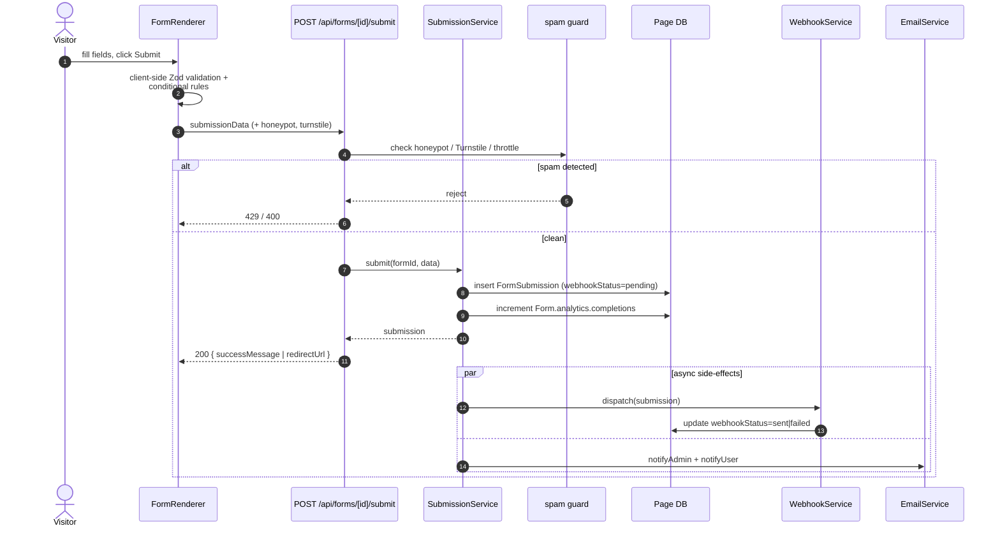

### 2.3.3 Blog analytics — track then report

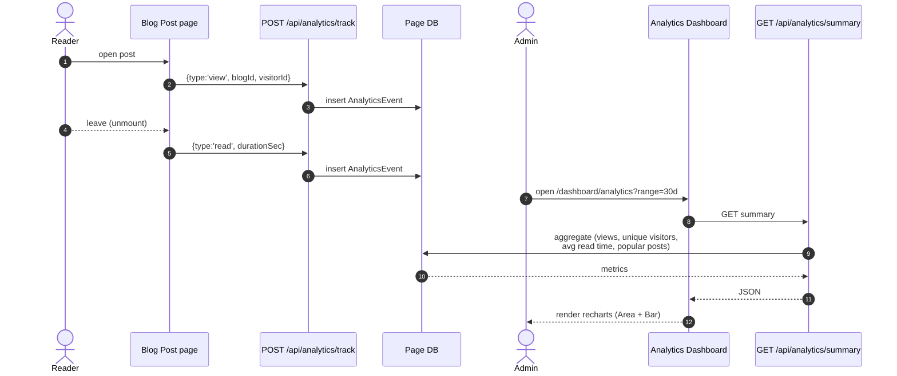

## 2.4 Activity diagrams

### 2.4.1 AI-assisted onboarding (starter-site generation)

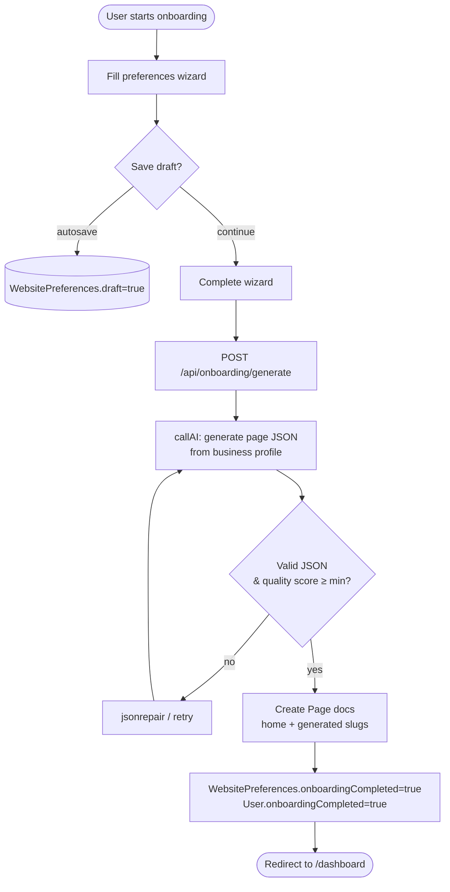

### 2.4.2 Blog post lifecycle (author → publish)

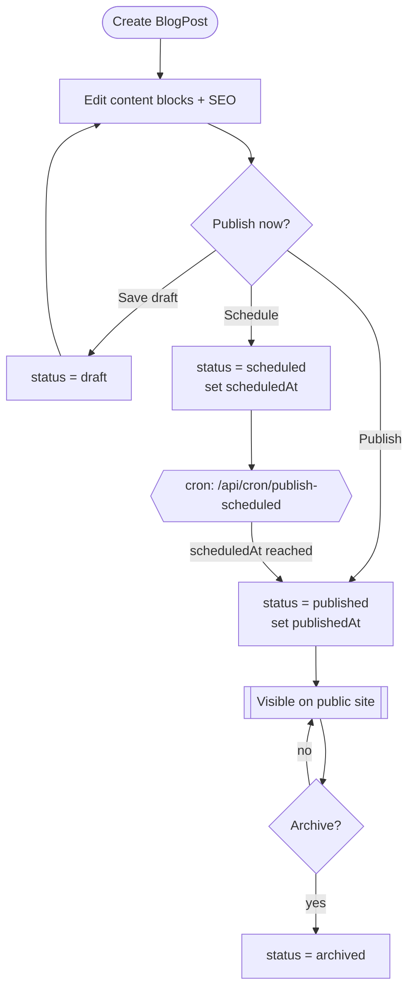

## 2.5 State-transition diagrams

### 2.5.1 BlogPost `status`

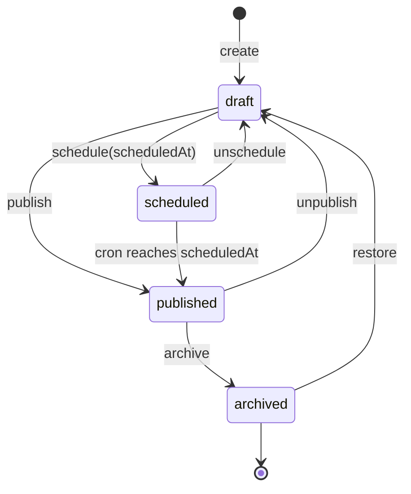

### 2.5.2 Form `status`

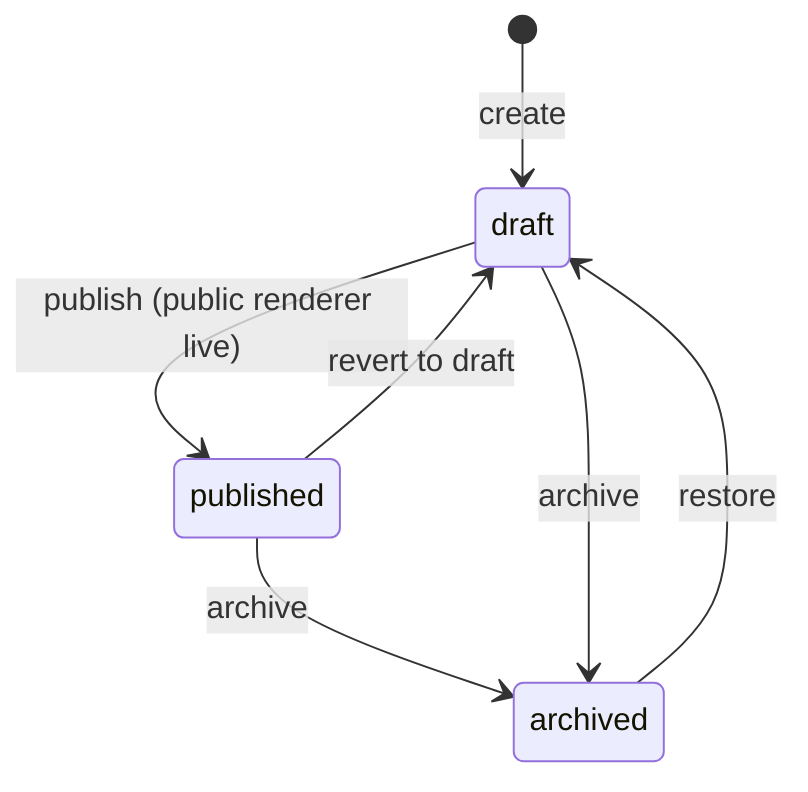

### 2.5.3 Comment moderation

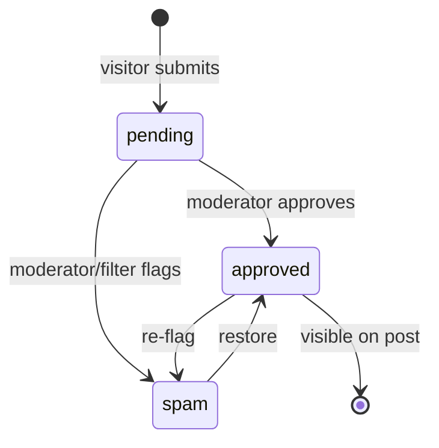

### 2.5.4 FormSubmission webhook delivery

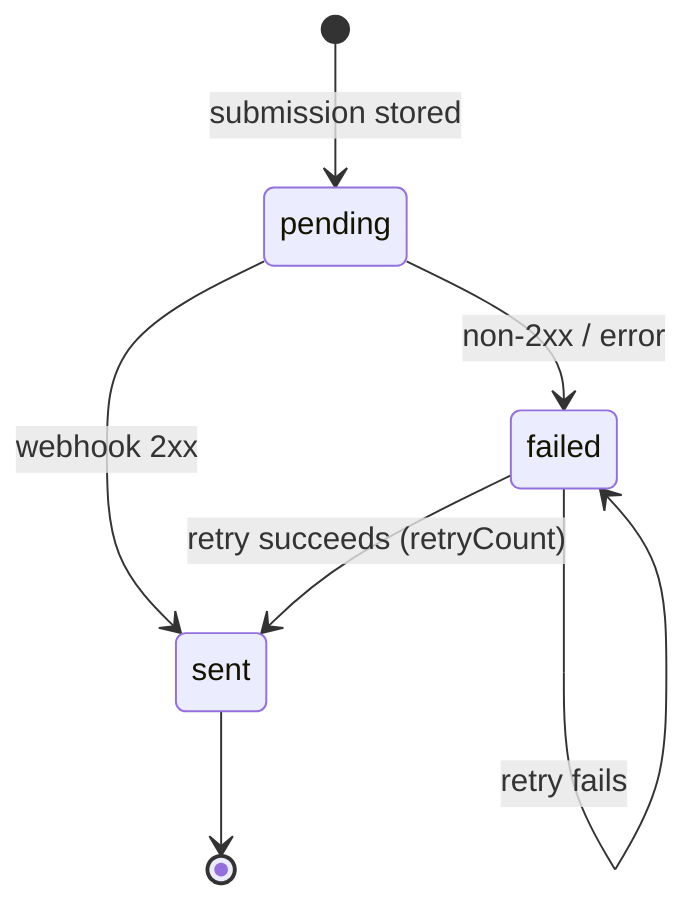

---

# 3. Forms Design

The form builder is a drag-and-drop designer whose output is a `Form` document (§1.3). Editor state is normalized in Redux (`formBuilderSlice`: `fieldsById` + `fieldOrder[]` + `selectedFieldId`).

## 3.1 Field-type catalog

`FormFieldType` (`src/types/form-builder.ts`) → renderer (`src/components/form-builder/fields/registry.tsx`):

| Category | Field types | Renderer |
|----------|-------------|----------|
| **Text inputs** | `text` · `email` · `phone` · `number` · `url` · `password` · `date` · `time` | `TextInputField` |
| **Long text** | `textarea` | `TextareaField` |
| **Choice** | `dropdown` · `radio` · `checkbox` | `DropdownField` · `RadioField` · `CheckboxField` |
| **Rating** | `rating` | `RatingField` |
| **Special** | `file` · `signature` | `FileUploadField` · `SignatureField` |
| **Structural** | `section_header` · `divider` · `hidden` | `SectionHeaderField` · `DividerField` · `HiddenField` |

Each field supports: `label`, `placeholder`, `helpText`, `required`, `defaultValue`, `validation` (min/max length, regex, pattern, custom), `width` (25/50/75/100 %), `order`, `conditionalRules` (nested AND/OR), `options` (choice fields), `step` (multi-step index), `cssClass`.

## 3.2 Form builder screen layout (wireframe)

```
┌──────────────────────────────────────────────────────────────────────────┐
│  Form Builder                       [ Preview ] [ Settings ⚙ ] [ Save ▸ ]  │
├───────────────┬──────────────────────────────────────┬─────────────────────┤
│ FIELD LIBRARY │            FORM CANVAS               │  PROPERTIES PANEL    │
│ (draggable)   │        (dnd-kit sortable)            │  (selected field)    │
│               │                                      │                      │
│ ▸ Text        │  ┌────────────────────────────────┐  │  Label   [________]  │
│ ▸ Email       │  │ ▤ Section: Contact details     │  │  Required [x]        │
│ ▸ Phone       │  ├────────────────────────────────┤  │  Width  [ 50% ▼]     │
│ ▸ Dropdown    │  │ Full name *      [__________]   │  │  Placeholder […]     │
│ ▸ Radio       │  │ Email *          [__________]   │  │  ── Validation ──    │
│ ▸ Checkbox    │  │ Phone            [__________]   │  │  min/max, regex…     │
│ ▸ Date/Time   │  │ ── divider ──                  │  │  ── Conditional ──   │
│ ▸ File        │  │ Message          [▭▭▭▭▭▭▭▭]   │  │  show if … = …       │
│ ▸ Rating      │  │                                │  │                      │
│ ▸ Signature   │  │      [   Submit   ]            │  │                      │
│ ▸ Section     │  └────────────────────────────────┘  │                      │
└───────────────┴──────────────────────────────────────┴─────────────────────┘
```

## 3.3 Public form (rendered) & settings surfaces

- **Renderer** (`FormRenderer.tsx`, page `/forms/[slug]`): honors multi-step (progress bar + Back), conditional show/hide/require, spam guard (honeypot + Cloudflare Turnstile + throttle), file upload constraints, then POSTs to `/api/forms/[id]/submit`.
- **Settings drawer** groups: *Submit* (button text, success message, redirect), *Multi-step*, *Notifications* (admin/user email templates), *Webhook* (URL, method, headers, retry), *Spam*, *File upload*.

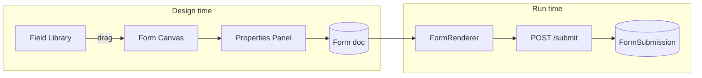

---

# 4. Reports Design

Three analytics/report surfaces, all rendered with **recharts** (wrapped by `src/components/ui/chart.tsx`).

## 4.1 Report inventory

| # | Report | Route | Data source | Charts |
|---|--------|-------|-------------|--------|
| A | **Blog Analytics** | `/dashboard/analytics` ← `GET /api/analytics/summary?range=7d\|30d\|all` | `AnalyticsEvent` aggregation | Stat cards (Views, Unique Visitors, Avg Read Time); Area (views/day); Bar (popular posts, top categories); list (search queries) |
| B | **Form Analytics** | `/dashboard/plugins/form-builder/[id]/analytics` ← `/api/forms/[id]/analytics` | `Form.analytics` + submissions | Stat cards (Views, Starts, Completions, Conversion %); Area (timeline); Bar (drop-off by field / funnel) |
| C | **Menu-Redirect Analytics** | menu-redirect plugin ← `/api/menu-redirect/analytics` | `MenuRedirectAnalytics` counters | Stat card (Total clicks); Bar (clicks by link); ranked list (top links w/ share %) |

> The **dashboard home** (`/dashboard`) shows DB-connection status cards (master/user/page) plus a LineChart currently backed by mock data — a candidate to wire to report A.

## 4.2 Blog Analytics dashboard layout (wireframe)

```
┌───────────────────────────────────────────────── Range: [7d] [30d] [All] ┐
│  ┌───────────┐  ┌───────────────┐  ┌───────────────┐                       │
│  │  Views    │  │ Unique        │  │ Avg Read      │   ← stat cards        │
│  │  12,480   │  │ Visitors 3,921│  │ Time  2m 14s  │                       │
│  └───────────┘  └───────────────┘  └───────────────┘                       │
│  ┌──────────────────────────────────────────────────────────────────────┐ │
│  │  Views over time                            (AreaChart)               │ │
│  │      ╭╮       ╭─╮                                                      │ │
│  │   ╭──╯╰──╮╭──╯  ╰────╮                                                 │ │
│  └──────────────────────────────────────────────────────────────────────┘ │
│  ┌───────────────────────────────┐  ┌───────────────────────────────────┐ │
│  │ Popular posts (Bar, top 10)   │  │ Top categories (Bar)              │ │
│  │ Post A  ████████████ 1,204    │  │ News      █████████ 812           │ │
│  │ Post B  ████████ 903          │  │ Guides    ██████ 540              │ │
│  └───────────────────────────────┘  └───────────────────────────────────┘ │
│  ┌──────────────────────────────────────────────────────────────────────┐ │
│  │ Top search queries: "pricing" (48) · "docs" (31) · "api" (22) …       │ │
│  └──────────────────────────────────────────────────────────────────────┘ │
└────────────────────────────────────────────────────────────────────────────┘
```

## 4.3 Form Analytics — conversion funnel

```
┌─ Form: "Contact us" ──────────────────────────────────────────────────────┐
│  Views 4,010   →   Starts 2,140   →   Completions 1,560   →  Conv. 38.9%   │
│  ┌──────────────────────────────────────────────────────────────────────┐ │
│  │ Timeline: views vs completions               (AreaChart)             │ │
│  └──────────────────────────────────────────────────────────────────────┘ │
│  ┌──────────────────────────────────────────────────────────────────────┐ │
│  │ Drop-off by field (Bar — abandonment count per fieldId)              │ │
│  │ phone      ████████ 410                                              │ │
│  │ message    ████ 180                                                  │ │
│  └──────────────────────────────────────────────────────────────────────┘ │
└────────────────────────────────────────────────────────────────────────────┘
```

## 4.4 Report data flow

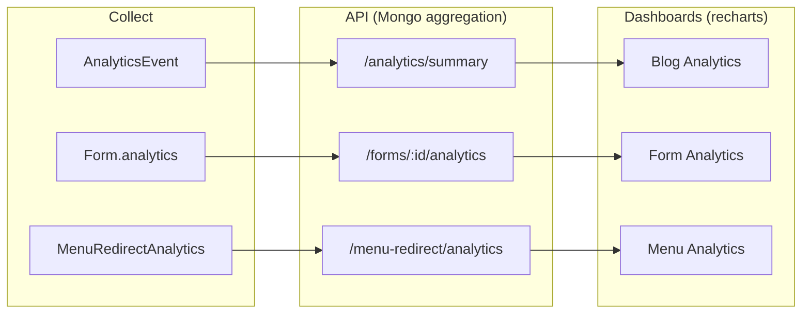

---

### Appendix — security note carried from the codebase

`requireAuth` (`src/lib/api/auth.ts`) currently **decodes** the JWT (`jwtDecode`) but does **not cryptographically verify** the signature — a documented placeholder. The sequence diagrams above show the intended verified flow; hardening `requireAuth` to call `verify(token)` (HS256 with `JWT_SECRET`) is a recommended next step before production.
